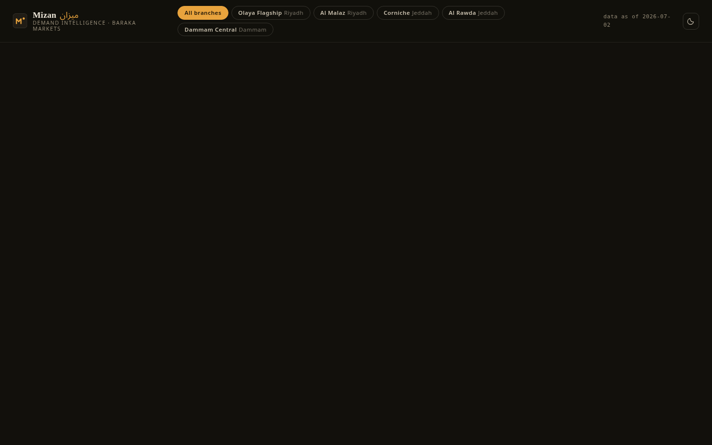
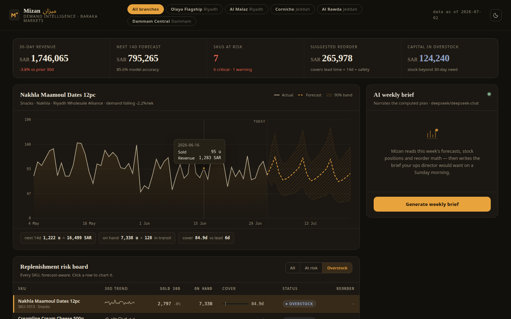
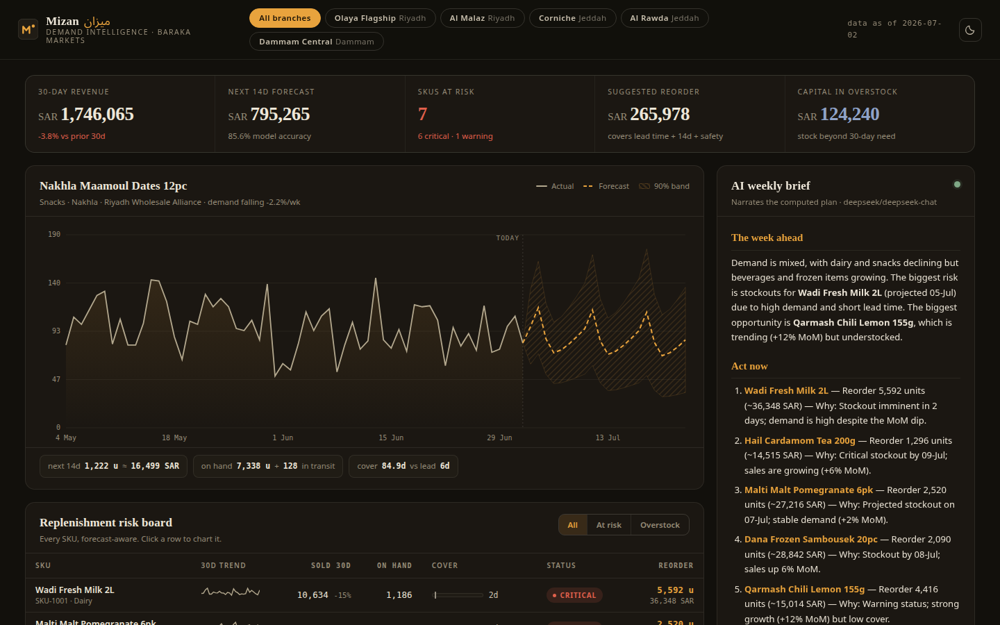

# Mizan: demand forecasting for multi-branch food retail

Demand forecasts, stockout risk and reorder plans for a fictional five-branch Saudi supermarket chain. The math does the analysis; the AI writes the weekly brief on top of the computed figures.

ميزان: توقع الطلب وتنبيهات إعادة الطلب لسلاسل محلات الأغذية.



## What it does

- **21-day forecasts per product.** Weekday seasonality plus a damped linear trend, fitted on 180 days of history, with a 90% confidence band. Classical and explainable: every number on screen can be traced.
- **Replenishment risk board.** All 24 products classed as critical, warning, healthy or overstock by walking the forecast against stock on hand, with days of cover, lead-time markers, projected stockout dates and 30-day trend lines.
- **Reorder plan.** Order quantities rounded to whole cases, covering lead time, the review period and safety stock at a 95% service level, each with its cost in SAR.
- **Merchandising calls.** What to push (rising demand, good margin, healthy cover), what to discount (money tied up in overstock) and what to watch, each with its reason.
- **Branch view.** One click reruns the whole analysis for a single branch.
- **AI weekly brief.** The model receives only the computed figures, never raw data, and writes the Sunday-morning brief: the week ahead, moves to make now with quantities and cost, merchandising calls and a watch list. It never invents a number.




## Run it

No runtime dependencies (plain `node:http`). The data is generated in memory on start and is the same on every run.

```bash
OPENROUTER_API_KEY=your-key npm start   # http://localhost:4940
```

Only the AI brief needs the key; everything else works without it. The model defaults to `deepseek/deepseek-chat` and can be changed with `OPENROUTER_MODEL`.

## Tests

```bash
npm install && npx playwright install chromium
OPENROUTER_API_KEY=your-key npm run e2e   # starts the server, drives the full flow, checks the live AI call, saves screenshots/
```

## Stack

Node with no runtime dependencies, hand-drawn SVG charts (no chart library, no CDN), a vanilla JavaScript single-page app in light and dark themes, OpenRouter for the brief, Playwright for the end-to-end test.

The chain, its branches, products and sales are fictional sample data.
